# RollCall System Architecture (`ARCHITECTURE.md`)

**Take-Home Task A: Who Is in the Photo?**

RollCall runs strictly on `127.0.0.1` as a self-contained local web workbench for folder enrollment, open-set group photo identification, human-in-the-loop attendance review, and print/CSV/PNG reporting with zero network calls at runtime.

---

## 1. Architecture Diagram (Generated with Archify)

The architecture diagram below was authored directly from committed repository evidence (`HEAD` `39e3cf83986bc2351d05eec437ebd296ad911cb7`) and validated through **Archify v3.3.1** (`validate`, `deliver`, `check`, and `browser-check` gates passing with 14 repository source citations):

- **Static SVG export:** [`docs/rollcall-architecture.svg`](docs/rollcall-architecture.svg)
- **Interactive Archify HTML diagram** (3 guided views: *Full System*, *Enrollment & Health*, *Identify & Review*): [`docs/rollcall-architecture.html`](docs/rollcall-architecture.html)

---

## 2. Real Modules in This Repository

| Layer | Module(s) | Responsibility |
| --- | --- | --- |
| **Offline Model Prep** | [`scripts/setup_models.py`](scripts/setup_models.py) | Downloads YuNet + SFace ONNX weights once online prior to disconnecting; writes SHA-256 sizes & digests to `models/manifest.json`. Never runs during app startup or inference. |
| **Frontend Workbench** | [`static/index.html`](static/index.html), [`static/styles.css`](static/styles.css), [`static/app.js`](static/app.js), [`static/print.css`](static/print.css), [`static/print.js`](static/print.js) | Single-screen Studio Inspector: interactive photo canvas, aspect-preserving Mini Coverage Map, Enrollment Health modal (`Keep`/`Reject` + multi-face picker), `About this run` drawer, Keyboard Review Queue (`J/K/R/S/C/A/U/Z`), and print-sheet launcher. Zero external URLs or CDN libraries. |
| **API & Security Guard** | [`rollcall/app.py`](rollcall/app.py), [`rollcall/self_check.py`](rollcall/self_check.py), [`rollcall/config.py`](rollcall/config.py) | FastAPI server bound to `127.0.0.1:8000` with strict `Content-Security-Policy` (`default-src 'none'`, docs/redoc disabled), startup self-check (SHA-256 verification, zero-CDN check, SQLite check), and a 2-worker `ThreadPoolExecutor` for CPU inference. |
| **Ingest & Health Studio** | [`rollcall/image_utils.py`](rollcall/image_utils.py), [`rollcall/filename_parser.py`](rollcall/filename_parser.py), [`rollcall/enrollment.py`](rollcall/enrollment.py) | `ImageOps.exif_transpose` orientation correction, `1200 px` reference pre-scale / `2400 px` group cap, original-pixel quality gate, system-file filtering (`.DS_Store`, `Thumbs.db`, `__MACOSX`), multi-face holdout, and `T_high` extra-photo consistency guard. |
| **CV Detection & Second Look** | [`rollcall/engine/base.py`](rollcall/engine/base.py), [`rollcall/engine/opencv_engine.py`](rollcall/engine/opencv_engine.py), [`rollcall/second_look.py`](rollcall/second_look.py) | Abstract `FaceEngine` + `OpenCVYuNetSFaceEngine` (`FaceDetectorYN` + `FaceRecognizerSF`), `suppress_artifact_detections` (`IoU > 0.25`, `containment > 0.40`, `< 0.65` reference secondary drop), overlapping tiled Second Look (`2×2` / `3×2` at 20% overlap), and manual-box detection (`0.35` floor capped at `Likely`). |
| **Calibration & Matching** | [`rollcall/calibration.py`](rollcall/calibration.py), [`rollcall/matcher.py`](rollcall/matcher.py) | Computes folder-level `99.5th` percentile across distinct identity pairs -> `T_low` clamped to `[0.363, 0.50]` (`N < 15` fallback) and `T_high = max(T_low + 0.06, 0.44)`, classifies Lookalike (`>= 0.42`) vs Possible Duplicate (`>= 0.55`) pairs, enforces `0.05` / `0.10` runner-up margins, and supports optional Hungarian uniqueness without overriding weak/`Likely` states. |
| **Persistence & Audit** | [`rollcall/db.py`](rollcall/db.py) | Local SQLite (`runtime_data/rollcall.db`) holding active identities, crops, **opt-in** SHA-256 embedding cache (`persist_cache=False` by default), and append-only `decision_trail`; wiped completely by `POST /api/wipe`. |
| **Exports & Eval** | [`rollcall/exporter.py`](rollcall/exporter.py), [`scripts/evaluate.py`](scripts/evaluate.py), [`scripts/build_practice_group.py`](scripts/build_practice_group.py) | Generates annotated PNGs, CSV exports, and XSS-escaped HTML print sheets (`DEMO DATA` banner, Page 1 summary, Page 2+ Decision Trail appendix), plus CLI evaluation and practice data generation scripts. |

---

## 3. Architectural Trade-Offs (Decisions Made by the Author)

Every architectural trade-off below reflects an explicit design choice you directed during development:

1. **Single Lightweight Offline Engine (`YuNet + SFace`) vs. Shipping Multiple Heavy Backends**
   - **What we chose:** Implemented `OpenCVYuNetSFaceEngine` alone behind a modular `FaceEngine` interface (`rollcall/engine/base.py`), deferring InsightFace (`SCRFD` + `ArcFace`) cleanly without bundling `onnxruntime` / CoreML EP complexity upfront.
   - **What we gave up:** Stronger raw detection recall on tiny, dense back-row faces that heavier models like RetinaFace/SCRFD sometimes achieve, and CoreML hardware acceleration tuning.
   - **Why (Author's Decision):** OpenCV Zoo models avoid InsightFace's non-commercial pre-trained weight clause, run cleanly inside Python 3.11 on an 8 GB M2 Mac without dependency bloat, and let us prove one end-to-end baseline before complicating debugging.

2. **Open-Set Three-Tier Decisions (`Confirmed` / `Likely` / `unknown`) + Optional Gated Hungarian vs. Forced Top-1 Matching**
   - **What we chose:** Prefer `"unknown"` or `"Likely"` (human review, **not** counted Present) over forced Top-1 matches. Independent per-face matching is default; even when Hungarian 1-to-1 assignment runs, it can never upgrade weak/`Likely` faces or bypass dummy `"unknown"` nodes.
   - **What we gave up:** Higher automated `"Present"` coverage on borderline or close-similarity faces (e.g., lookalike pairs separated by `< 0.10` margin).
   - **Why (Author's Decision):** Core principle: *"RollCall should prefer an honest unknown result over a confidently incorrect identity."*

3. **Folder-Level `99.5th` Impostor Calibration (`0.363` Floor, `0.50` Cap, `N < 15` Fallback) vs. Fixed or Uncapped Thresholds**
   - **What we chose:** Calibrate `T_low` at the `99.5th` percentile across distinct identity pairs when `N >= 15`, clamp to `[0.363, 0.50]` with an explicit cap warning, compute `T_high = max(T_low + 0.06, 0.44)`, and disclose the one-photo-per-person limitation in **About this run**.
   - **What we gave up:** Estimating genuine same-person variance during enrollment (not measurable from single-photo-per-person folders) and allowing runaway upward threshold drift on odd/homogeneous folders.
   - **Why (Author's Decision):** Prevents one noisy or lookalike-heavy folder from causing mass false rejections while documenting every calibration assumption honestly.

4. **Ephemeral Embeddings by Default + Reviewer Edits Never Touch Reference Embeddings**
   - **What we chose:** Keep SQLite embedding caching **opt-in** (`persist_cache=False` default), remove `enroll_new` from group review, hold mismatched extra photos (`sim < T_high`) out of matching until Keep/Reject, and isolate reviewer corrections (`C` / `A` / `U` / `Z`) to session attendance logged in an append-only `decision_trail`.
   - **What we gave up:** Automatic fast warm caching across server restarts unless opted in, and one-click enrollment of un-enrolled group strangers during review.
   - **Why (Author's Decision):** Face embeddings are sensitive biometric templates; session mistakes during group review must never silently corrupt reference identities across runs.

5. **`1200 px` Reference Pre-Scale + Overlap/Score Artifact Suppression vs. Single `2400 px` Detector Scale Everywhere**
   - **What we chose:** EXIF-transpose first, pre-scale reference portraits to `1200 px` max side (while measuring face pixel dimensions in original-image pixels) and drop overlapping (`IoU > 0.25` / `containment > 0.40`) or weak (`< 0.65`) secondary boxes; keep group photos at `2400 px` + overlap suppression only + user-triggered `Second Look` / `Draw Box` (`0.35` floor capped at `Likely`).
   - **What we gave up:** Weak (`< 0.65`) distant bystanders in reference portraits no longer trigger the multi-face selector automatically.
   - **Why (Author's Decision):** Fixed real close-up portrait double-detections (`1/50 -> 0/50` false splits on hi-res synthetic sets) that otherwise caused annoying false `Needs attention` interruptions and slow enrollment (`~13.4 s -> ~8.0 s`).

6. **Browser-Native Print (`window.print()`) + Zero External Dependencies + Strict CSP vs. SPA / PDF Frameworks**
   - **What we chose:** Vanilla HTML/CSS/ES6 JS served locally under Strict CSP (`default-src 'none'`), paste-folder-path fallback alongside `webkitdirectory`, and an escaped HTML print sheet (`include_thumbs=False` default) using browser Print / Save as PDF.
   - **What we gave up:** Programmatic binary `.pdf` generation and complex frontend build tooling.
   - **Why (Author's Decision):** Zero external runtime dependencies guarantees 100% offline reliability, zero CDN/script leakage, and straightforward evaluation across machines.
